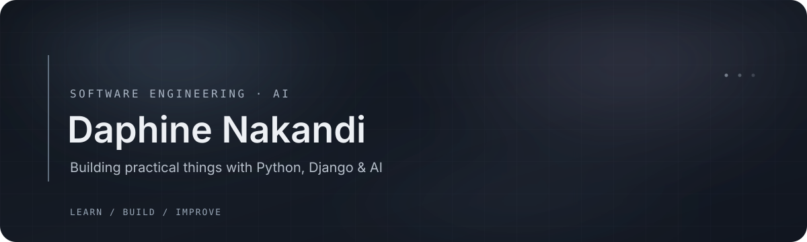

### Software Engineering · Python · Django · AI Applications

Building practical software, exploring ideas, and improving one project at a time.

[GitHub](https://github.com/DaphineNakandi) · [LinkedIn](https://linkedin.com/in/daphine-nakandi-03b5a6241/)

---

## About

I'm a software engineering learner focused on building useful applications and understanding how they work from the inside out. My current interests include backend development, AI-powered applications, and user-focused frontend experiences.

- Building applications with **Python and Django**
- Developing REST APIs with **Django REST Framework**
- Exploring **React** and frontend integration
- Experimenting with **LLMs, LangChain, and retrieval-augmented generation**
- Practising problem-solving, testing, and clean version control

## Featured Projects

<table>
<tr>
<td width="50%" valign="top">

### [Hardware System Management](https://github.com/DaphineNakandi/Hardware-System-Management)

A Django application for managing hardware inventory, stock entries, suppliers, sales, and customer deposits. Includes REST API development and ongoing frontend integration.

Python · Django · DRF · REST API

</td>
<td width="50%" valign="top">

### [AI Interview Prep Coach](https://github.com/DaphineNakandi/interview-prep-coach)

An AI-powered interview practice application with role-specific questions and mock interview experiences.

Python · Streamlit · OpenAI SDK · OpenRouter

</td>
</tr>
<tr>
<td width="50%" valign="top">

### [LangChain Developer Assistant](https://github.com/DaphineNakandi/langchain-dev-assistant)

An AI developer assistant exploring tool use and retrieval-augmented generation with a vector database and evaluation workflow.

LangChain · ChromaDB · RAG · RAGAS

</td>
<td width="50%" valign="top">

### [Interactive Learning Tool](https://github.com/DaphineNakandi/interactive-learning-tool)

A Python learning application that uses AI to generate questions and evaluate answers.

Python · LLM · JSON

</td>
</tr>
</table>

### More projects

- [D&D Combat](https://github.com/DaphineNakandi/dnd-combat) — A Python project exploring object-oriented programming and game logic.
- [Community Days — Automotive App](https://github.com/DaphineNakandi/communitydays_group_5) — A collaborative group project.

## Tech Stack

**Languages:** Python · HTML · CSS

**Backend:** Django · Django REST Framework · REST APIs

**Frontend:** React (currently learning)

**AI & LLMs:** OpenAI SDK · OpenRouter · LangChain · Prompt Engineering · RAG

**Data & Retrieval:** ChromaDB · Vector Databases · RAGAS

**Tools:** Git · GitHub · VS Code · Streamlit

---

*Curious by nature. Practical by choice. Always learning.*

